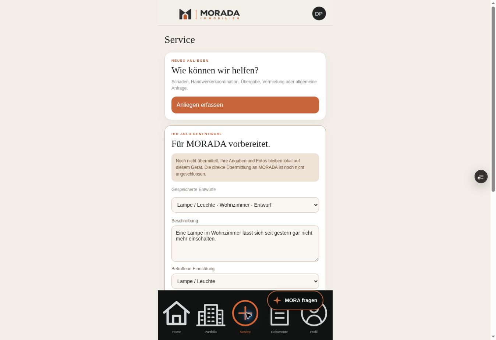

# MORA AI 2.0 — Reliability Upgrade

Stand: 20. Oktober 2026. Repository `dianaporschke/morada.mora.ai`, ausschliesslich `codex/mora-ai-2.0`. Mercury 2.5 bleibt über den bestehenden Vercel AI Gateway angebunden.

## Ziel und untersuchte Verarbeitungskette

Kundennachricht → echte Mercury-Ausgabe → validierte Fakten → signierter Gesprächszustand → erlaubte lokale Aktion → Speicherung im vorhandenen Serviceentwurf → überprüfte Formularwerte.

Der gemeldete Lampenfall wird nicht nur über den Text im Chat beurteilt. Entscheidend sind `equipment`, Kategorie, Defekt, Raum, Anzahl sowie der tatsächlich gespeicherte und gerenderte Entwurf.

## Gefundene Ursachen

1. In den früheren echten Testbelegen enthielt der Defekt eine Lampe, während `equipment` weiterhin `unknown` war. Der Modellauftrag verlangte interne Codes, gab deren vollständige Zuordnung aber nicht an. Die Daten wurden ohne gemeinsame Normalisierung übernommen. Das war ein Extraktions-/Vertragsproblem vor der Anzeige, kein reines Labelproblem. Der neue Ausgangslauf reproduziert in seiner ersten Antwort `unknown`; erst die nächste Antwort liefert den freien Alias `Lampe`.
2. Server und Browser hatten getrennte Einrichtungs-/Kategorielisten und Zusammenfassungen. Der Browser kopierte den Zustand in den Entwurf; fehlende oder uneinheitliche Codes blieben bestehen.
3. Eine lokale Vorbereitung besass keinen Rückkanal in den signierten Gesprächszustand. Derselbe Vorbereitungsbutton konnte trotz gespeichertem Entwurf wieder angeboten werden.
4. Bekannte und fehlende Werte wurden nicht durchgängig von ausdrücklich unbekannten oder unsicheren Angaben unterschieden. Ein unbekannt gewordener Beginn konnte einen alten Wert behalten; widersprüchliche Kandidaten brauchten einen eigenen Status.
5. Fehlgeschlagene lokale Speicherung konnte trotzdem wie eine erfolgreiche Vorbereitung weiterbehandelt werden. Ausserdem setzte erneutes Speichern den Lieferstatus zurück.
6. Die erste Live-Prüfung fand weitere Wahrheitsfehler: eine passive Zusage, Angaben würden nach einem Klick übermittelt, sowie die Behauptung einer bereits erfolgten Entwurfsaktualisierung. Beides ist nicht verfügbar beziehungsweise vor dem Klick nicht ausgeführt und wird jetzt abgefangen.
7. Eine abgewiesene Modellformulierung konnte trotz bereits unabhängig geprüfter Sachangaben die gesamte Verarbeitung verwerfen. Dieser Datenverlust wird jetzt getrennt vom Fehler der Formulierung behandelt.

## Geänderte Komponenten

| Bereich | Dateien | Wirkung |
|---|---|---|
| Gemeinsames Datenmodell und Mapping | `assets/mora-data.js`, Reexport in `lib/mora/equipment.js` | Gemeinsame Codes, Kategorien, kontrollierte Aliasse, explizite Mengen, Zusammenfassungen und `mapServiceDraft` |
| Modellvertrag und Anweisungen | `schema.js`, `conversation-contract.js`, `instructions.js`, `understanding.js` | Codeübersicht im Kontext, sparse Updates, explizite Unbekannt-/Unsicherheitszustände, keine erfundene Versandmöglichkeit |
| Gesprächszustand | `engine.js`, `context.js` | Revisionsverwaltung, Herkunft und Status pro Feld, Korrekturen, getrennte Anliegen, begrenzter Modellkontext |
| Aktionen und Wahrheit | `actions.js`, `dialogue.js`, `api/chat.js` | Erlaubte Aktionen bleiben serverseitig geprüft; bestätigte lokale Revisionen und tatsächliche Einreichung bleiben getrennt |
| MORA-Client | `assets/mora-client.js` | Speichern vor Erfolg, kein automatischer Versand, wiederholte Klicks idempotent, denselben Entwurf aktualisieren, lokale Eingaben erhalten |
| Fehlergrenze | `structured.js`, `understanding.js`, `api/chat.js` | Geprüfte Fakten nach abgewiesener Formulierung erhalten; `responseMode: recovery` und klarer technischer Hinweis |
| Nachweise | `tests/reliability.test.js`, angepasste Clienttests, `scripts/reliability-*` | Automatisierte Vertragsprüfungen und getrennte echte Mercury-/HTTP-/DOM-Läufe |

Die allgemeinen Portaldateien, `index.html`, CSS, Navigation, Anmeldung, Rollenansichten, Datenbanken und allgemeinen Serviceformulare werden nicht umgebaut. Der vorhandene `/api/requests`-Adapter bleibt bestehen und standardmässig deaktiviert.

## Wie das Mapping funktioniert

`mapServiceDraft(issue, existingDraft)` ist die gemeinsame, browserfähige Mappinggrenze. Die folgenden Daten werden aus dem bestehenden Anliegen übernommen:

| Anliegenfeld | Serviceentwurf | Behandlung |
|---|---|---|
| `category` | `category` | Zulässige Kategorie; eindeutige bekannte Einrichtung bestimmt ihre feste Kategorie |
| `equipment` | `equipment` / vorhandene Einrichtungswahl | Beispielsweise `light` = Lampe / Leuchte; auch `Lampe` als eindeutiger Alias wird zu `light` |
| `defect` | Konkreter Defekt | Eigenes Feld; nicht nur unter Zusatzangaben |
| `count` | Anzahl | Nur vorhandene Modellangabe beziehungsweise ausdrückliches Zahlwort neben einer bekannten Einrichtung; keine eins aus „meine Lampe“ |
| `location` | Betroffener Bereich | Korrigierter Wert ersetzt den vorherigen Raum |
| `since` | Beginn | Unbekannt bleibt `null` mit eigenem Unbekanntstatus; nicht angegeben bleibt davon unterscheidbar |
| `extent` | Umfang | Eigene Angabe beziehungsweise kontrollierte Mengenbeschreibung |
| `details`, `cause` | Weitere Angaben / Zusammenfassung | Keine Diagnose erfinden; Quelle bleibt in den Gesprächsfakten |
| `description` | Beschreibung | Vorhandene Beschreibung; bei Korrekturen aus gültigen Fakten aktualisiert |
| `attachments` | Lokale Dateimetadaten | Kein Uploadbeleg und keine Bildanalyse |

Ein eindeutiger ausdrücklich genannter Objekttyp darf nicht als `unknown` verloren gehen, nur weil sein Untertyp fehlt. Die genaue Lampenart ist beispielsweise eine optionale Zusatzangabe. Mehrere unterschiedliche Objekte werden nicht durch den ersten Worttreffer willkürlich einer Kategorie zugeordnet. Ein unbenanntes Teil unter dem Lavabo wird nicht allein deshalb zu einem Rohr.

`fieldFacts` unterscheidet `known`, `unknown`, `not_provided`, `corrected` und `uncertain`. Ein unsicherer Kandidat wird neben dem zuletzt bestätigten Wert gespeichert. Sparsame `null`-Werte löschen nichts; ausdrückliche Rücknahmen und Unbekanntangaben können Werte entfernen. Lokale Änderungen im Serviceentwurf haben Vorrang vor stillem Überschreiben. Andere Chatwerte erzeugen einen sichtbaren Konflikthinweis.

## Aktionszustände und Bestätigung

| Zustand | Bedeutung / Auslöser |
|---|---|
| `not_prepared` | Im Chat verstanden, kein durch diese Aktion bestätigter Entwurf |
| `ready` | Ein lokaler Entwurf kann aus den vorhandenen Angaben vorbereitet werden |
| `preparing` | Vorbereitung läuft; Chat-/Aktionssperre verhindert parallele Klicks |
| `created` | Der neue lokale Entwurf wurde gespeichert |
| `updated` | Dieselbe Anliegen-ID wurde mit neuen Angaben gespeichert |
| `error` | Lokale Speicherung scheiterte; keine Erfolgsmeldung, erneuter Versuch möglich |
| `portal_received` | Der Entwurf ist in der vorhandenen lokalen Serviceansicht verfügbar; Clientbestätigung mit exakter Datenrevision |
| `sent` | Nur vorhandener echter serverseitiger Beleg mit Vorgangs-ID; durch Vorbereitung oder Browserbestätigung nicht erzeugbar |

Die transienten Vorbereitungszustände liegen im MORA-Client. Persistente Fakten und lokale Bestätigungen tragen Datenrevision und Anliegen-ID. Der Speicherschlüssel ist die stabile Anliegen-ID. Wiederholtes Klicken auf dieselbe Version erzeugt keinen zweiten Entwurf und keinen weiteren Modellaufruf. Nach neuen Chatangaben kann „Entwurf aktualisieren“ dieselbe ID fortschreiben.

Eine `draftReceipt` wird ausschliesslich für eine vorhandene Anliegen-ID und die exakte signierte Revision akzeptiert. Ihre Herkunft bleibt `client_local_storage`. Sie bestätigt keine Portal-Backend-Speicherung, keine Berechtigung und keinen Versand. Details und der spätere Backendvertrag stehen in `MORA_PORTAL_INTERFACE_CONTRACT.md`.

## Zuverlässiger Umgang mit abgewiesener KI-Sprache

Eine unzulässige Antwort wird weiterhin höchstens einmal durch das echte Modell korrigiert. Schlägt auch die Korrektur fehl, können ausschliesslich vorher unabhängig validierte Sachangaben erhalten werden. Referenzen, Quellzuordnung und physische Komponenten müssen davor geprüft sein. Fehlerhafte Quellen oder eine nicht strukturell validierte Ausgabe werden nicht auf diesem Weg zu Fakten erklärt.

Der sichtbare Text ist dann ausdrücklich ein technischer Hinweis. API und Nachweise markieren `responseMode: recovery` und `recoveredFacts: true`. Das ist keine erfolgreiche natürliche KI-Antwort und wird bei der Sprachqualität auch nicht so gezählt. Es wird kein Versand, keine Reparatur und kein fertiger Entwurf vor dem Speichervorgang behauptet. Das eigentliche Modell und sein begrenzter Korrekturversuch bleiben unverändert; es gibt keinen Wechsel auf vorgefertigte fachliche Dialogbäume.

## Automatisierte Regressionen

**259 automatisierte Prüfungen bestanden; Typecheck, Syntax-/Asset-Prüfung und Build bestehen.** Siehe `docs/evidence/reliability-regression-summary.txt`. Diese Prüfungen verwenden gezielt Mock-Ausgaben und kontrollierte Speicherfehler; sie sind keine Belege für echte Modellintelligenz. Echte KI-Ausgaben und ihre tatsächlich gerenderten Entwurfsfelder werden separat dokumentiert.

## Echte Mercury-Prüfung

Der vollständige Lauf umfasst **15 Szenarien und 25 Gesprächsrunden** auf Build `4b48865`: 14 Szenarien mit echten Mercury-Antworten, ein separater unmittelbarer Gefahrenfall ohne Modellaufruf. In allen 15 vorbereiteten aktiven Entwürfen stimmen die übertragenen Felder mit dem validierten Zustand überein. HTTP-Fehler: 0. Eine Runde verwendet ausdrücklich den technischen Wiederherstellungsweg; sie zählt nicht als erfolgreiche natürliche Antwort. Die 24 Modellrunden benötigen insgesamt 30 Generierungen einschliesslich sechs Korrekturversuchen.

Eine solche Mappinggleichheit allein beweist keine vollständige Erfassung oder fehlerfreie Sprache. Die manuelle Prüfung fand einen ausgelassenen Negativhinweis und zusätzliche falsche Versandformulierungen. Diese Befunde wurden behoben und als Regressionen aufgenommen. Deshalb wird hier keine allgemeine Premium-Sprachfreigabe ausgesprochen.

Anschliessend wurden **sechs Szenarien mit acht echten Modellrunden** auf Build `edb1a5b` wiederholt: vollständige Lampe, ursprünglicher Tippfehlerfall, drei Lampen, wiederholtes Klicken, Ergänzung nach bereits gespeichertem Entwurf und nicht verfügbare Einreichung/Beauftragung. Alle überprüften Daten-, Mengen-, Negativangaben-, Identitäts- und Mappingprüfungen bestehen. Der erneute Lauf enthielt allerdings nochmals eine sprachliche Aufforderung, einen Versand per Klick zu bestätigen. Diese reale Formulierung ist nun zusätzlich im finalen Build `8ed88f2` blockiert und regressionsgeprüft; sie wird nicht rückwirkend als korrekte Modellantwort gewertet.

Der **abschliessende echte Browserlauf** auf `8ed88f22d5357ef2439c748e429a2b010e59e3c2` prüft Kundeneingabe, normale Mercury-Antwort, tatsächlichen Klick, vorhandene Serviceansicht und Neuladen. Ergebnis:

| Tatsächliches Servicefeld | Verifizierter Wert |
|---|---|
| Auswahl / Titel | Lampe / Leuchte · Wohnzimmer · Entwurf |
| Einrichtung | `light` / Lampe / Leuchte |
| Beschreibung | Eine Lampe im Wohnzimmer lässt sich seit gestern gar nicht mehr einschalten. |
| Defekt | lässt sich nicht einschalten |
| Anzahl | 1 |
| Bereich | Wohnzimmer |
| Beginn | seit gestern |
| Weitere Angaben | Keine weiteren Symptome |
| Anzahl gespeicherter Entwürfe | genau 1, auch nach Neuladen |
| Übermittlung | ausdrücklich noch nicht übermittelt |

Die sichtbare Modellantwort bietet einen lokalen, prüfbaren Entwurf an und behauptet keinen Versand. Der Browsernachweis liest die tatsächlichen Formularwerte aus; er ist kein Mock. Serverlogs bestätigen zwei Generierungen für diese Antwort, 8.455 ms gesamte Serverzeit und anschliessend eine lokale Entwurfsbestätigung mit 1 ms Serverzeit und **0 Modellaufrufen**. Die Browser-Konsole zeichnet das Timing nur als Objekt auf; daraus wird kein genauer zusätzlicher Browserlatenzwert erfunden.

### Abgedeckte Situationen

| Nr. | Situation | Beleg / Ergebnis |
|---|---|---|
| 1 | Vollständige defekte Lampe | Echter Browsernachweis einschliesslich aller oben aufgeführten Felder und Reload |
| 2 | Mehrere kurze Folgeantworten | Raumkorrektur auf Schlafzimmer; Lampe und Anzahl 1 bleiben erhalten |
| 3 | Tippfehler / Umgangssprache | `meine lampe nicht gehen` → `wohnzimmer, eine lampe, nein` erreicht eindeutig `light`, Wohnzimmer, Anzahl 1 |
| 4 | Korrektur einer Raumangabe | Zwei Steckdosen bleiben zwei; Schlafzimmer ersetzt Wohnzimmer auch in der Beschreibung |
| 5 | Unbekannter Beginn | `since: null`, ausdrücklich `unknown`, keine erfundene Zeit |
| 6 | Mehrere Einrichtungen | Drei Lampen im Flur; zusätzliche Negativangaben bleiben im Nachtest erhalten |
| 7 | Mehrere Anliegen | Wohnzimmerlampe seit Montag und Badezimmerheizung seit gestern getrennt zugeordnet; aktiver Entwurf tatsächlich übernommen, weiterer Datensatz separat im Zustand |
| 8 | Themenwechsel | Dokumentenfrage und Rückkehr zur Lampe erhalten dasselbe Anliegen; keine persönlichen Dokumente erfunden |
| 9 | Widerspruch / Unsicherheit | Bestätigte Anzahl 1 bleibt; „vielleicht zwei“ wird als unsicher markiert |
| 10 | Wiederholte Klicks | Genau ein Entwurf, stabile ID, keine zusätzlichen Generierungen durch die Klicks |
| 11 | Ergänzung nach Vorbereitung | Derselbe Entwurf erhält Schlafzimmer; keine zweite Anliegen-ID |
| 12 | Übergabefehler | Reales Modell plus absichtlich ausgelöster lokaler Speicherfehler: kein falscher Erfolg; erneuter Versuch speichert genau einen Entwurf |
| 13 | Unbekannte Kategorie | Allgemeines Anliegen / unbekannte Einrichtung; keine zufällig gewählte Fachkategorie |
| 14 | Elektrische Gefahr | Lokale Sicherheitsantwort ohne Modellaufruf; im vollständigen Lauf 11 ms Serverzeit |
| 15 | Nicht verfügbare Aktion | Kein Versand, keine Elektrikerbeauftragung; nur lokaler Entwurf |

Der Speicherfehler ist eine kontrollierte Fehlereinspritzung am heutigen lokalen Übergabepunkt, kein Test eines noch nicht vorhandenen Portal-Backends. Der Mehrfachanliegen-Lauf belegt zwei getrennte Faktenbestände und die tatsächliche Übernahme des aktiven Anliegens. Die Übernahme beider Anliegen nacheinander ist zusätzlich in den automatisierten DOM-Tests abgedeckt; es wird keine nicht vorhandene gemeinsame Versandschnittstelle behauptet.

### Originalantworten und Belege

- [Vollständiger Lauf mit 15 Szenarien](evidence/reliability-live-complete.json)
- [Sechs gezielte Nachtests](evidence/reliability-live-final-targeted.json)
- [Manuelle Prüfung und ausdrücklich festgehaltene Sprachfehler](evidence/reliability-manual-review.json)
- [Echter Browsernachweis mit Formularwerten und Reload](evidence/reliability-browser-proof.json)
- [Serverlogs des Browserlaufs](evidence/reliability-browser-runtime.txt)
- [Ausgangsfall vor dem Upgrade](evidence/reliability-before.json)
- [Erster Pilot und nicht beschönigte Fehler](evidence/reliability-live-pilot.json)
- [Zwischenstand vor der Faktenwiederherstellung](evidence/reliability-live-pre-recovery.json)

### Geschwindigkeit

Im vollständigen Lauf liegt der Median der Serverzeit der Modellrunden bei 6,05 Sekunden; im gezielten Nachtest bei 7,98 Sekunden. Das sind verschiedene Szenarien und Validierungsstände, kein sauberer Vorher-/Nachher-Geschwindigkeitsvergleich. Die künstliche Wartezeit zwischen Testanfragen gehört nicht zur berichteten Serverzeit. Es wird kein allgemeiner Geschwindigkeitsgewinn behauptet. Reine lokale Entwurfsbestätigungen benötigen keinen Modellaufruf. Zusätzliche Reparaturversuche bleiben sichtbar und können Zeit und Tokenverbrauch erhöhen; Tarife, Schlüssel und kostenpflichtige Einstellungen wurden nicht verändert.

## Weiter bestehende technische Grenzen

- Entwürfe und Fotos werden lokal im Browser gespeichert. Es existiert weiterhin kein produktiver Versand, keine echte Vorgangsnummer und kein bestätigter Bearbeitungsstatus.
- Eine Clientbestätigung über den lokalen Servicebereich ist keine Serverquittung.
- Browserfehler, ungültige Sitzungen und Modellfehler ohne sichere Teilfakten können nicht als Erfolg behandelt werden. Der Chat erhält die Möglichkeit zur Wiederholung; es werden keine Fakten erfunden.
- Mercury bleibt für Natürlichkeit, Kontextdeutung und zuverlässige Einhaltung aller Sprachvorgaben ein Qualitätsfaktor. Geprüfte Mappinggrenzen lösen diese Modellschwäche nicht vollständig.
- Streaming wird in diesem Auftrag nicht ergänzt. Ungeprüfte Teilantworten werden nicht als bestätigte Aktionen angezeigt.

## Benötigte Portal-Schnittstellen

Alexander muss später authentifizierte, objektbezogene Adapter für versioniertes Anlegen/Aktualisieren von Entwürfen, ausdrücklich bestätigte Einreichung, Uploadquittungen sowie berechtigte Dokument-, Termin- und Statusabfragen bereitstellen. MORA implementiert kein zweites Portal. Der genaue vorgeschlagene `createOrUpdateDraft`-/`submitRequest`-Vertrag mit Idempotenz, Versionskonflikten, Rückgabeformat und Fehlercodes steht im aktualisierten Schnittstellenvertrag.

## Preview und Branchschutz

Geprüfte Preview: https://morada-mora-dmj4rphbr-dianaporschke-1255s-projects.vercel.app/

Finaler funktionaler Commit: `8ed88f22d5357ef2439c748e429a2b010e59e3c2`. Nachfolgende Dokumentations-/Belegcommits verändern den getesteten Anwendungscode nicht. Kein Merge und kein Produktionsdeployment. Mercury 2.5, vorhandene Gateway-Anbindung, API-Schlüssel und kostenpflichtige Einstellungen bleiben unverändert.

GitHub-Abschlussprüfung der geschützten Referenzen: `main` bleibt auf `0b86dfc3344df62d3de02d8297959a495cc822d3`, `alex-portal` auf `15bfa257ddbe312f7f4658b342ec4703b869b90e`. Beide Werte entsprechen der Prüfung vor dem ersten Schreibzugriff.
